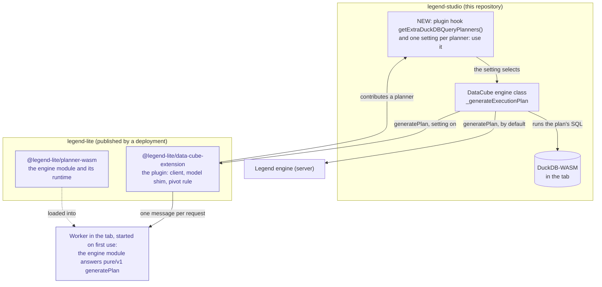
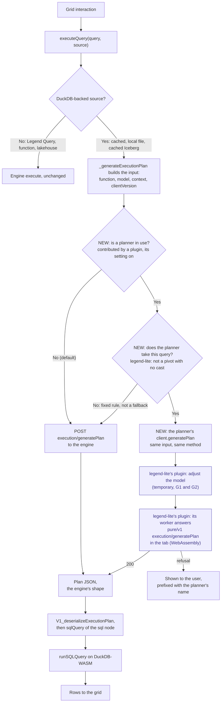
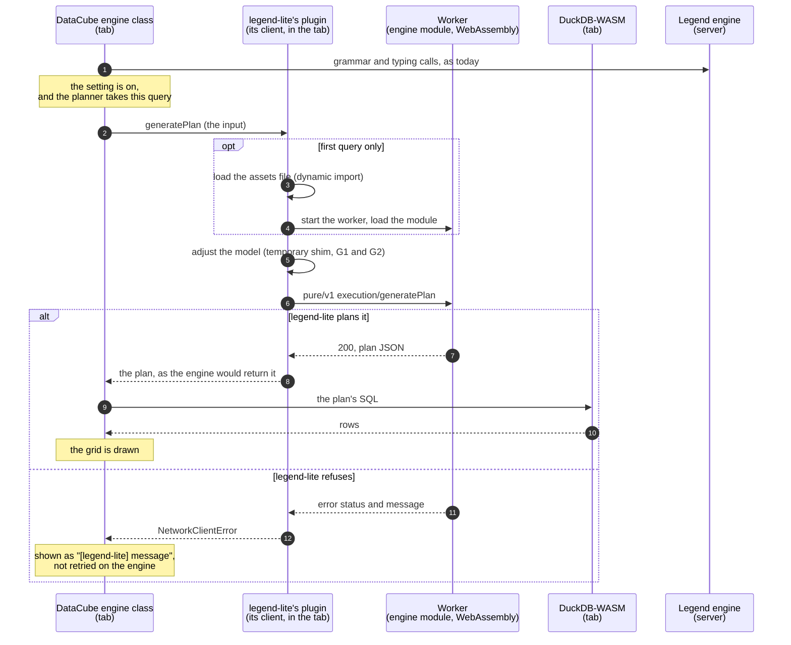

# Integrating legend-lite into legend-studio's apps: a proposal (2026-11-18)

**Status:** proposed, not ratified. Phase 1 is built and in two pull requests; nothing is merged.
[MauricioUyaguari/legend-studio#2](https://github.com/MauricioUyaguari/legend-studio/pull/2) adds a generic planner
hook to DataCube and no legend-lite code. [neema2/legend-lite#120](https://github.com/neema2/legend-lite/pull/120)
holds legend-lite's engine module as a package and the plugin that contributes legend-lite as a planner. This document
is the source of the proposal posted at https://github.com/finos/legend-studio/discussions/5930 (its first comment).
Section 10 lists the decisions that are the user's.

**Corrected on 2026-11-18**, after the first step was implemented
([`LEGEND_STUDIO_PHASE_1_IMPLEMENTATION_PLAN_2026_11_18.md`](LEGEND_STUDIO_PHASE_1_IMPLEMENTATION_PLAN_2026_11_18.md)).
Sections 7.0, 7.1, 7.2 and 9 first described one setting with three values and three files from legend-lite. What
was built has two boolean settings and two files from legend-lite, with the worker written in legend-studio.
Section 7.1 says why.

**Corrected again on 2026-11-19 and 2026-11-20.** legend-lite's `pure/v1` routes moved into an engine module of
their own, so the package is that module; section 3 says so, and sections 4 and 5 give where the refusals are now
raised and the module's size. And legend-lite's client became a subclass of `V1_EngineServerClient`; sections 7.0
and 7.1 say so. The implementation plan has the details.

**Corrected again on 2026-11-23.** legend-studio is released publicly, so its build cannot depend on a package that
is not on the public registry. legend-lite's client, worker, model shim and pivot rule moved out of legend-studio into
a plugin in the legend-lite repository, and legend-studio keeps a generic hook. Sections 6, 7.0 to 7.2, 10 and 11
say so; 7.0 now has three diagrams. And the first step has no compare (shadow) mode: one setting uses the planner
(7.3).

**The question (the user, 2026-11-18):** the quickest path to integrate legend-lite into the apps of the
legend-studio repository (Studio, Query, Taxonomy, Marketplace, DataCube), lowest risk first, reusing
legend-lite's WebAssembly where possible. For example: use the wasm planner inside legend-studio's
DataCube to compile a Pure query and get its SQL. How hard is that, and what has to change?

**Evidence:** both repositories were read (legend-lite `main` at `4dfbb5b76`, legend-studio at
`c40833edd`), and nine spikes were run against a freshly built planner module. The scripts and how to run
them are in [`legend-studio-integration-homework/`](legend-studio-integration-homework/README.md).
Section 11 says what was not verified.

---

## Contents

- [1. The answer in brief](#1-the-answer-in-brief)
- [2. The apps, and how much each depends on the engine](#2-the-apps-and-how-much-each-depends-on-the-engine)
- [3. What legend-lite offers](#3-what-legend-lite-offers)
- [4. What the spikes showed](#4-what-the-spikes-showed)
- [5. The gaps found](#5-the-gaps-found)
- [6. Where a second planner plugs into legend-studio](#6-where-a-second-planner-plugs-into-legend-studio)
- [7. Phase 1 in detail](#7-phase-1-in-detail)
  - [7.0 The design: three diagrams](#70-the-design-three-diagrams)
  - [7.1 Changes in legend-studio](#71-changes-in-legend-studio)
  - [7.2 Changes in legend-lite](#72-changes-in-legend-lite)
  - [7.3 Shadow mode: not in phase 1](#73-shadow-mode-not-in-phase-1)
  - [7.4 What phase 1 does not do](#74-what-phase-1-does-not-do)
  - [7.5 How hard, honestly](#75-how-hard-honestly)
- [8. Risks](#8-risks)
- [9. The later phases](#9-the-later-phases)
  - [9.1 The other candidates, and where each stands](#91-the-other-candidates-and-where-each-stands)
- [10. Decisions that are the user's](#10-decisions-that-are-the-users)
- [11. What was not verified](#11-what-was-not-verified)

---

## 1. The answer in brief

**Start with the standalone DataCube app, on its DuckDB-backed sources only, replacing one engine call
(`generatePlan`) with the wasm planner, behind a setting that is off by default.**

- **It works today, with no legend-lite change, if the request is adjusted on the legend-studio side.**
  The planner answers `generatePlan` in the engine's own plan shape; legend-studio's own deserializer reads
  it and DataCube's own extraction logic finds the SQL (spike 09). Eleven of twelve DataCube-shaped
  queries planned (spike 04), typically in 5 to 10 ms each once the module is warm.
- **It does not work unmodified.** The exact model DataCube sends is refused, for two small reasons
  (section 5, G1 and G2). Either a 20-line shim in legend-studio or two small fixes in legend-lite removes
  both.
- **The change is confined to one legend-studio package**, `legend-application-data-cube`, which only the
  DataCube app depends on. Query, Studio and Marketplace are untouched.
- **Do not start with the "wasm executor".** It refuses the model DataCube sends, needs DuckDB versions
  aligned, and replaces code that already works. Planner first; executor is phase 3.
- **Taxonomy is not a candidate:** it was removed from legend-studio in 2023.

The recommended order, by risk:

| Phase | What | Touches | Users affected |
|---|---|---|---|
| 0 | Package the planner; build a conformance corpus from legend-studio's own DataCube tests | Both repos, no app | None |
| 1 | DataCube app: `generatePlan` for DuckDB-backed sources answered in the tab, behind one opt-in setting | `legend-application-data-cube` | DataCube, opt-in only |
| 2 | DataCube app: typing and grammar calls in the tab, so a cached cube needs no engine per click | Same package; three new routes in legend-lite | DataCube |
| 3 | The in-tab execute path (the "wasm executor") | Same package; legend-lite | DataCube |
| 4 | Grammar and typing routed to legend-lite for Query and Studio, by configuration | `legend-graph` (every app) | Query, Studio: per deployment |
| 5 | Execution on a legend-lite server | legend-lite server | Later; needs connections, pointers, test execution |

---

## 2. The apps, and how much each depends on the engine

All five talk to the engine through one class, `V1_EngineServerClient`
(`legend-graph/.../v1/engine/V1_EngineServerClient.ts`), which has about 100 endpoint methods.

| App | Needs the engine for | Other servers | Blast radius of a change |
|---|---|---|---|
| **DataCube** (standalone, v0.7) | Grammar, typing, `execute`, `generatePlan`, typeahead, the DataCube store | Depot, lakehouse | **Smallest.** `legend-application-data-cube` is depended on only by its own bootstrap. It builds its own `V1_RemoteEngine` and holds its own client. |
| **Query** (v13.8) | Query store, `execute`, `modelCoverage`, grammar, return types; embeds DataCube and Legend Cube | Depot | Large. Shares `legend-query-builder` and `legend-graph` with Studio. |
| **Studio** (v28.21) | Nearly the whole client: compile, grammar, tests, generation, service registration, database utilities | SDLC, Depot | Largest. |
| **Marketplace** (v0.5) | Little: a few grammar, typing and execute calls through the data-product extension | Many (marketplace, registry, Depot, several lakehouse services) | Small engine surface, but the most other dependencies. |
| **Taxonomy** | Removed in commit `c5e583974` (2023-05-31) | | Not applicable |

Three facts decide the order:

1. **DataCube is the most isolated consumer and already runs SQL in the tab.** For a cached source, a local
   file or a cached Iceberg table, it calls the engine's `generatePlan`, takes the SQL out of the plan, and
   runs it on its own DuckDB-WASM (`LegendDataCubeDataCubeEngine.ts:1058-1143`). The engine is needed there
   only as a compiler. That is exactly the job the wasm planner does.
2. **The shared library is where the risk is.** `legend-graph` is depended on by every app, about 15
   extensions and the VS Code extension. A change to `V1_EngineServerClient` or `V1_RemoteEngine` reaches
   all of them. Phase 1 changes none of it.
3. **There is no plugin hook for the engine.** No request interceptor exists and no plugin can supply an
   engine. The seams that do exist are listed in section 6.

Two things worth knowing that were not asked:

- **Query embeds DataCube** through a different engine class (`QueryBuilderDataCubeEngine`), which has no
  DuckDB caching. Phase 1 does not reach it.
- **Legend Cube** (`legend-cube`, `legend-cube-builder`, v0.0.5) has the cleanest seam in the repository: a
  nine-method `CubeEngine` interface with an injectable implementation. It mostly executes against real
  warehouses, so the planner helps it less than it helps DataCube, but it is the easiest second target.

---

## 3. What legend-lite offers

One compiler, three builds: a JVM server answering legend-engine's `pure/v1` API over HTTP, a WebAssembly
module answering the same routes in a Web Worker, and a native library for Python
(`docs/DATACUBE_ARCHITECTURE.md` section 4.4, added by
[neema2/legend-lite#117](https://github.com/neema2/legend-lite/pull/117)).

The export that matters here is `pureV1OrError(path, rawQuery, body)`: one legend-engine route, answered
in-process by the code the server answers it with (`PureV1Routes.route`). Its contract is legend-engine's API,
which makes it the one stable surface of the module.

Since 2026-11-18 the WebAssembly build is two modules. The planner module (`//wasm:planner`) answers
legend-lite's own operations and has no legend-engine route. The engine module (`//wasm:engine_planner`) has
`pureV1OrError` and execute's halves, and loads on its own. Everything in this proposal uses the engine module.

**The routes legend-studio's DataCube calls, against what legend-lite answers** (through the module and
over HTTP alike, unless noted):

| Route | Answered | Note |
|---|---|---|
| `grammar/grammarToJson/lambda` | Yes | Reads only `returnSourceInformation`; ignores `sourceId` and the offsets |
| `grammar/grammarToJson/model` | Yes | |
| `grammar/jsonToGrammar/lambda` (and `/batch`) | Yes | `PRETTY` and `STANDARD` |
| `compilation/lambdaRelationType` | Yes | Plain type names (section 5, G10) |
| `compilation/lambdaReturnType` | Yes | |
| `execution/generatePlan` | Yes | The engine's plan shape; limits in section 5 |
| `execution/execute` | HTTP only | Runs on the project's own database, not a real connection. Refused through the module: the host runs the SQL |
| `grammar/grammarToJson/valueSpecification` | **No (404)** | Called once per load |
| `grammar/jsonToGrammar/valueSpecification` | **No (404)** | **Called on every grid fetch** (section 7) |
| `compilation/lambdaRelationType/batch` | **No (404)** | |
| `codeCompletion/completeCode` | **No (404)** | Typeahead; errors are swallowed by the editor |
| `compilation/autofix/transformTdsToRelation/lambda` | **No (404)** | Legacy TDS queries only |
| `pure/v1/query`, `pure/v1/query/dataCube` | HTTP, with `--query-store` | A separate module in the tab |

---

## 4. What the spikes showed

All run on 2026-11-18 in Node 25 against `bazel build //wasm:planner` from `main` at `4dfbb5b76`. On
2026-11-19, after legend-lite moved these routes into its engine module, spikes 01, 02, 03, 05, 07 and 10 were
run again against that module alone (`//wasm:engine_planner`, `main` at `b75d6c73a`) and gave the same results.
Spikes 04 and 09 were not run again. Spikes 06 and 08 also call held-model exports (`planJsonHeldOrError`,
`relationTypeHeldOrError`) that the planner module no longer exports under those names, so they do not run as
written.

| # | Experiment | Result |
|---|---|---|
| 01 | The engine's routes through the module, on legend-lite's own test model | All answered. The plan is `simple > relationalTdsInstantiation > sql`, with the SQL in `sqlQuery`. Module load 140 ms; first plan 26 ms; warm 8 ms |
| 02 | The in-tab execute halves | Accept the model **only as Pure text that the host already serves**. Inline model JSON is refused |
| 03 | **The exact model DataCube synthesizes** for a DuckDB-backed source | **Refused**: `connection value has no 'postProcessorWithParameter'`. With that field supplied: `an embedded runtime connection is unprobed` |
| 04 | The same model with those two things adjusted | **11 of 12 DataCube-shaped queries plan**, 5 to 20 ms each after the first (195 ms, cold). The table is addressed as `"main"."cache1"`, which is where DataCube puts it |
| 05 | Each aggregate alone; pivot; errors | `last()` fails with an internal error. A pivot with no cast yields SQL that is not runnable as text |
| 06 | The model as Pure text | `generatePlan` works with **no change on either side**. With the model held once, a plan takes **0.6 ms** (median of 20) |
| 07 | Arithmetic on a nullable column (`$x.amount * 2`) | **Compile error** unless written `$x.amount->toOne() * 2` |
| 08 | Each query re-serialized by **legend-studio's own protocol classes** | 8 of 8 plan to the same SQL |
| 09 | legend-lite's plan read by **legend-studio's own deserializer** and DataCube's extraction logic | The SQL is extracted |

What the queries in 04 covered: filter, select, groupBy with a count column, sort, slice, limit, leaf and
group-level extend, `in`, `isEmpty`, `not`, `and`/`or`, case-insensitive contains, `startsWith`,
`endsWith`, column-against-column, date literals, `today()`, `now()`, the variance and standard-deviation
aggregates, `joinStrings`, `uniqueValueOnly`, `average`, `min`, `max`, `first`, pivot with a cast, and the
grid's count-then-sum drilldown pattern.

---

## 5. The gaps found

Each is a specific, reproducible refusal or difference. "Owner" says which repository would change.

| # | Gap | Evidence | Owner | Size |
|---|---|---|---|---|
| **G1** | The model reader requires `postProcessorWithParameter` on a relational connection. legend-studio's serializer omits empty arrays, so it is never sent | Spike 03; `ConnectionReader.java:138` | legend-lite | Small |
| **G2** | `generatePlan` refuses a connection embedded in the runtime. DataCube embeds it and emits no connection element | Spike 03; `PureV1Routes.java:539` | legend-lite | Small |
| **G3** | A pivot with no cast is a two-statement plan in legend-lite (keys first, then the body per key). In the engine-shaped plan its `sqlQuery` is not runnable. DataCube runs exactly this query, with `limit 0`, to discover the pivot's columns | Spike 05; register S110 | Either | Medium |
| **G4** | The `last()` aggregate fails: `an instance literal has no row scope for $x` | Spike 05 | legend-lite | Small to medium |
| **G5** | Arithmetic on a nullable column is a compile error. Whether legend-engine accepts it was not checked. If it does, this is a compile gap that user-written extended columns will hit often | Spike 07; `Typer.java:1122` | legend-lite, after checking the engine | Unknown |
| **G6** | Five routes DataCube calls answer 404 (section 3) | Spike 02 | legend-lite | Small each, except typeahead |
| **G7** | The in-tab execute halves take only a text model the host serves | Spike 02; `HostAnswers.java:234` | legend-lite | Small |
| **G8** | A model given as a pointer (project coordinates) is refused. DataCube's engine-backed sources send pointers | `ModelInput.java:89-98` | legend-lite | Large: needs Depot |
| **G9** | Errors carry no `sourceInformation`. A parse error's position is in the message text only; a compile error names the element in words. DataCube's editors place markers from `sourceInformation` | Spike 05 | legend-lite | Medium |
| **G10** | Type names are plain (`String`, `Float`, `StrictDate`). The engine answers precise primitives for database columns. DataCube accepts both vocabularies, and treats an unknown name as text | Spike 04; `UpstreamRelationType.java` | None needed for phase 1 | |
| **G11** | DuckDB versions differ: legend-studio pins `@duckdb/duckdb-wasm` 1.31.0; legend-lite is tested on 1.33.1-dev57 (DuckDB 1.5.4). legend-lite's SQL also assumes a UTC session; DataCube sets none | `package.json` of each | Both | See section 8 |
| **G12** | Nothing is published. Every `package.json` is private and no workflow uploads the module. There is no versioning policy for the exports | Section 7 of the investigation | legend-lite | Small |
| **G13** | The module is 9.3 MB (3.45 MB gzip), not the 4.2 MB `wasm/README.md` states | The engine module, measured 2026-11-19 | Documentation | |

Not gaps, though they looked like ones:

- **The authentication tag.** DataCube's model serializes its test authentication as `h2Default`.
  legend-lite accepted it (spike 04).
- **The plan's shape.** legend-studio needs only a root node with a direct `sql` child carrying
  `sqlQuery`. legend-lite emits that, and its extra fields are ignored.
- **The lambda's JSON.** legend-studio's serializer writes the lambdas differently from legend-lite's
  parser (a different length in every case), and all of them were read (spike 08).

---

## 6. Where a second planner plugs into legend-studio

Four seams exist. They differ in how many apps they reach.

| Seam | Where | Reaches | Verdict |
|---|---|---|---|
| **A. `_generateExecutionPlan`** | One private method of `LegendDataCubeDataCubeEngine` (`:1718-1751`). It builds the input, calls the client, and deserializes | The DataCube app, its three DuckDB branches | **Recommended for phase 1** |
| B. `V1_EngineServerClient.request()` | The one method every endpoint funnels into; already overridden once (`:252-280`) | Every caller of that client instance | Phase 4: the right seam for routing by URL |
| C. A subclass of `V1_RemoteEngine` passed to `graphManager.initialize(config, {engine})` | DataCube and Marketplace already pass an engine this way | The graph-manager path, including DataCube embedded in Query | Phase 4, with B |
| D. `engine.url` in a deployment's `config.json` | No code | One whole deployment | Phase 5. Not usable yet: see below |

**Why not start with D, the zero-code option?** Pointing DataCube's `engine.url` at a legend-lite server
breaks more than it fixes today: the five 404 routes, no pointer models (so no Legend Query or function
sources), no real connections, and no sign-in. It becomes the simplest step once the server is ready,
which is the work the server team is doing. It is the last phase for that reason, not because it is hard.

**Why seam A.** It is one method in one package that only one app loads. The answer it must produce is
already defined (the engine's plan JSON), so the existing deserialization and SQL extraction are reused
unchanged. And because both the engine and the planner answer the same request, one setting switches between
them, and a comparison of the two stays possible (section 7.3).

**As built (2026-11-23): seam A, reached through a plugin hook.** DataCube's application plugin gets
`getExtraDuckDBQueryPlanners()`. The planner a plugin contributes hands DataCube an engine server client, so at
seam A DataCube calls `generatePlan` on the engine's client or the planner's, the same way. legend-lite's client
uses seam B inside itself: it is a subclass of `V1_EngineServerClient` whose `request()` asks the engine module.

---

## 7. Phase 1 in detail

**Goal:** for a cached source, a local file or a cached Iceberg table, the SQL DataCube runs on its own
DuckDB-WASM comes from the wasm planner instead of a round trip to the engine.

### 7.0 The design: three diagrams

Three diagrams, each a different kind of view of the same design:

- **Where the code lives** (a component diagram): what is in this repository, what is in legend-lite, and how they meet.
- **Which path a query takes** (a flowchart): the decisions a query goes through, and where each branch ends.
- **What happens, in order, when legend-lite is in use** (a sequence diagram): who asks whom, what loads on the first query, and what a refusal looks like.

In the first two, the shaded boxes are legend-lite's and live outside this repository; the boxes marked NEW are this repository's change; everything else exists today and is unchanged.

#### Where the code lives

This repository gets a generic hook and no legend-lite code. legend-lite's planner arrives as a plugin that a deployment registers, built from the legend-lite repository and published by that deployment.

#### Which path a query takes

#### What happens, in order, when legend-lite is in use

The first step has no compare mode (decided 2026-11-23): with the setting on, legend-lite plans the queries it takes, and nothing runs the engine's plan beside it.

The pieces, and where each lives:

| Piece | Where | New? |
|---|---|---|
| The input (`function`, `model`, `context`, `parameterValues`, `clientVersion`) | `_generateExecutionPlan`, `LegendDataCubeDataCubeEngine.ts:1718` | No |
| The hook, `getExtraDuckDBQueryPlanners()`, and the planner contract | `LegendDataCubeApplicationPlugin`, `stores/planner/` | Yes |
| One setting per contributed planner (use it) | `LegendDataCubeBaseStore.settings`, beside the two debugger settings there | Yes |
| The routing rule (a pivot with no cast goes to the engine) | legend-lite's plugin, as the planner's `isQuerySupported` | Yes, temporary (G3) |
| The model shim | legend-lite's plugin, in its client | Yes, temporary (G1, G2) |
| legend-lite's client, a subclass of `V1_EngineServerClient`, and its worker | legend-lite's plugin, `@legend-lite/data-cube-extension`, in the legend-lite repository | Yes |
| The module and its runtime (`classes.wasm`, `wasm-gc-module-runtime.js`) | The package `@legend-lite/planner-wasm`; emitted by the deployment's build, loaded on first use | Yes |
| Plan deserialization and SQL extraction | `LegendDataCubeDataCubeEngine.ts:1071-1078` | No |
| `runSQLQuery` and the conversion to a TDS result | `LegendDataCubeDuckDBEngine.ts` | No |

### 7.1 Changes in legend-studio

All in `packages/legend-application-data-cube`, and none of it names legend-lite
([MauricioUyaguari/legend-studio#2](https://github.com/MauricioUyaguari/legend-studio/pull/2)).

1. **The hook.** `LegendDataCubeApplicationPlugin.getExtraDuckDBQueryPlanners()` returns planners for
   DuckDB-backed sources. A planner is a `key`, a `label`, `createEngineServerClient()` (called once, when the
   planner is first asked) and an optional `isQuerySupported(query)`, a fixed rule by the shape of the query.
   `LegendDataCubeApplicationPlugin` and the planner types are exported from the package; the plugin class was not
   exported before, so no plugin outside the package could extend it.
2. **One setting per planner**, off by default, that uses it. Among planners whose setting is on, the first
   contributed wins. With none contributed, there is no setting.
3. **The branch.** In `_generateExecutionPlan`, call `generatePlan` with the same input object on the selected
   planner's client instead of the engine's, and hand its answer to the same `V1_deserializeExecutionPlan`. A
   failure is shown with the planner's label in front. Nothing falls back to the engine.
4. **Tests**, with a stand-in planner registered through the real plugin manager.

Nothing from legend-lite: no package, no asset, no worker.

### 7.2 Changes in legend-lite

**The plugin**, built, in [neema2/legend-lite#120](https://github.com/neema2/legend-lite/pull/120) at
`wasm/data-cube-extension` (`@legend-lite/data-cube-extension`):

1. **legend-lite's client**, a subclass of `V1_EngineServerClient` that overrides `request()`, the one method every
   method of that class ends in, to ask the engine module instead of a server. Every method keeps its name, input,
   output and errors (`NetworkClientError`), and nothing is ever sent to a server.
2. **Its worker**, which loads the module from the two URLs it is given and answers one `pure/v1` request per
   message, and the one file that names the module's files, loaded by a dynamic `import()` on first use.
3. **The temporary shim** for G1 and G2: before sending, move the embedded connection into its own `connection`
   element, point the runtime at it, and add `postProcessorWithParameter: []`.
4. **The routing rule** for the cast-less pivot (G3), as the planner's `isQuerySupported`.
5. **A guide** to publishing both packages to a private registry and registering the plugin in a deployment, with
   the bundling and serving requirements (`.wasm` as `application/wasm`, same origin, the content security policy).

**The package** `@legend-lite/planner-wasm` (`//wasm:engine_planner_package`, the same pull request): the engine
module and its runtime, as a directory an npm client reads. Publishing it is open (section 10).

**Changes to legend-lite's compiler.** None are required to start. These make the shim and the routing rule
unnecessary, in priority order:

1. **G1 and G2:** accept an absent `postProcessorWithParameter`, and plan over a runtime's embedded
   relational connection. Both are the server team's kind of work, and both also block any other
   legend-studio client that sends a synthesized model.
2. **G4:** the `last()` aggregate.
3. **G5:** ask the engine whether `$x.col * 2` compiles on a nullable column, and match it.
4. **G3:** for a DuckDB target, answer the cast-less pivot as one runnable statement in the
   engine-shaped plan.

### 7.3 Shadow mode: not in phase 1

*Decided on 2026-11-23: the first step has no shadow (compare) mode. The setting uses legend-lite's planner, and
nothing runs the engine's plan beside it. What follows is the design, kept for a later step if maintainers want one;
an earlier draft of the pull request had it, with five telemetry events.*

In `shadow`, DataCube asks both planners. The engine's SQL is the one that runs and the one the user sees.
The planner's SQL is then run on the same local DuckDB and the two results compared; a difference or a
refusal is recorded through DataCube's existing telemetry hooks. The data is local, so the second query
costs the user's machine a little and the engine nothing.

This gives a conformance corpus of real queries on real data with no user-visible risk. The setting moves
to `legend-lite` for opt-in users only once shadow differences are understood.

### 7.4 What phase 1 does not do

- **It does not remove the engine round trip per grid fetch.** Every `executeQuery` also awaits
  `getValueSpecificationCode(query)`, which calls `jsonToGrammar/valueSpecification` on the engine
  (`LegendDataCubeDataCubeEngine.ts:1034`), and legend-lite does not answer that route. Phase 1 swaps the
  planner; phase 2 removes the round trips.
- It does not touch engine-backed sources (Legend Query, functions, lakehouse). Those need `execute`
  against real stores and pointer models.
- It does not change DataCube embedded in Query.

### 7.5 How hard, honestly

My estimates, assuming one engineer who knows each codebase:

| Piece | Estimate |
|---|---|
| Phase 0: artifact and a first corpus lane | About a week |
| Phase 1 in legend-studio: client, assets, setting, branch, shim, tests | One to two weeks |
| Phase 1 in legend-lite: G1, G2, G4 | Days each, plus the upstream-fidelity checks legend-lite's rules require |
| Opt-in use before the setting is offered more widely | As long as it takes to see real usage; a few weeks |

The engineering is small. What takes time is being sure the SQL means the same thing, which is what phase
0's corpus and differential are for.

---

## 8. Risks

| Risk | Why it matters | Mitigation |
|---|---|---|
| **Same query, different rows** | legend-lite's SQL text differs from the engine's by design; its parity tests compare rows, on its own DuckDB version | Phase 0 corpus and differential. The setting is opt-in, so a difference reaches only users who chose it |
| **DuckDB version skew (G11)** | legend-lite records real version sensitivities (a `first()` shape on 1.5.0, an ASOF join on 1.4.4). Its SQL is untested on the DuckDB inside `duckdb-wasm` 1.31.0 | Run the corpus on legend-studio's pinned version. Consider aligning the pins; that is a DataCube-wide change and a decision (section 10) |
| **Session time zone** | legend-lite's SQL assumes `SET TimeZone='UTC'`; `today()` and `now()` become `current_date` and `now()`. DataCube's DuckDB keeps the browser's zone | Apply the planner's `sessionSetup` to DataCube's DuckDB, or confirm the engine's SQL has the same dependence |
| **Browser support** | The module needs WebAssembly GC and the newer exception-handling opcodes. A managed browser baseline may lag | Check the supported-browser baseline before phase 1. The setting stays off where unsupported |
| **Compile differences in user-written code (G5, G9)** | Extended columns hold arbitrary Pure. A stricter compiler or a missing error position degrades the editor | Phase 1 only plans queries the engine already typed. The editor's calls move in phase 2, after G5 and G9 |
| **An unstable module API (G12)** | legend-lite's own plan format is at version 51 and moves quickly | Use only `pureV1OrError`, whose contract is the engine's API. Pin the artifact by version |
| **Payload** | 3.4 MB gzipped on top of DuckDB-WASM | Lazy load: only when the setting is on and a DuckDB-backed source opens |
| **A new dependency in a FINOS repository** | legend-lite is not published and not a FINOS project | A decision (section 10) |
| **Silent divergence between planners** | A fallback that hides refusals also hides bugs; legend-lite's own rules forbid it | No silent fallback in `legend-lite` mode: a refusal is shown, with the planner named. Routing by query shape is fixed and written down |

---

## 9. The later phases

**Phase 0: packaging and a corpus (do first).**
- legend-lite publishes `classes.wasm` and its runtime as one versioned artifact, with types for the one
  export a host calls (`pureV1OrError`).
- A corpus lane in legend-lite built from legend-studio's own DataCube tests.
  `DataCubeQueryRoundtrip.data-cube-test.ts` is a 2,153-line suite whose cases are DataCube queries as
  Pure text, and CI there runs them against a live engine. Run each through `lambdaRelationType` and `generatePlan` and
  ratchet the count that plan. No test in legend-lite uses legend-studio's requests today.
- A differential against the engine: the same model and query to both, both SQLs run on one DuckDB, rows
  compared.

**Phase 2: typing and grammar in the tab (DataCube).** Once legend-lite answers the two
`valueSpecification` routes and `lambdaRelationType/batch` (G6), move `getValueSpecificationCode`,
`parseValueSpecification`, `_getLambdaRelationType` and the lambda grammar calls for DuckDB-backed sources.
After this a cached cube makes no engine call per interaction. Needs G5 and G9 first, because these calls
serve the editors. These three routes are also used by Query's saved-query load and by Legend Cube, so
they are the highest-leverage additions for the server team.

**Phase 3: the in-tab execute path.** Two different things are called the "wasm executor":
- *The execute halves* (`executeJsonPlan`, then the host runs the SQL, then `executeJsonAnswer`). They
  return the engine's result JSON, written by legend-lite's own writer and typed by the plan. DataCube
  today types results from Arrow type ids and converts every `bigint` to a JavaScript number, which loses
  precision; this would fix that. It needs G7, rows handed back in the exact form legend-lite's decoder
  produces, and DuckDB alignment (G11).
- *legend-lite's DuckDB client* replacing `LegendDataCubeDuckDBEngine`. That also moves ingestion and
  caching, and is a rewrite of code that works. Not recommended.

**Phase 4: Query and Studio, grammar and typing only.** Follow the precedent that already exists: the
client has a separate `queryBaseUrl` for the query store. Add an optional base URL for the grammar and
compilation routes, or route by path inside `request()`, and point it at a legend-lite server per
deployment. legend-lite's parity is strongest exactly here. This changes `legend-graph`, so it reaches
every app; gate it by configuration and start with one canary deployment. Server-side prerequisites
include zlib request bodies (Studio compresses), sign-in, CORS headers beyond `Content-Type`, and the
missing grammar routes.

**Phase 5: execution on a legend-lite server.** Needs real connections (the server opens no declared
Snowflake connection today), pointer models through Depot, test execution, and the rest of the list in the
investigation. This is the server team's roadmap, not an integration step.

### 9.1 The other candidates, and where each stands

The phases above are the recommended path. These were also considered. None is a phase of its own.

| Candidate | How it would plug in | Where it stands |
|---|---|---|
| **Legend Cube** (`legend-cube`, `legend-cube-builder`) | Its injectable nine-method `CubeEngine` (section 2) | The easiest second target after DataCube. Not scheduled: it mostly executes on real warehouses, so most of its value waits for phase 5. Its typing and grammar calls gain from the routes phase 2 adds |
| **DataCube embedded in Query** (`QueryBuilderDataCubeEngine`) | Seam C (section 6) | Not reached by phases 1 to 3: it has no DuckDB caching, so it runs no SQL in the tab. It gains from phase 4 |
| **Marketplace** | The shared extensions it already uses | Follows Query and Studio. Its engine use is small, so it gains from phase 4 without work of its own |
| **The wasm executor as the first step** | The execute halves in the DataCube app | Not first. It is phase 3 (section 1) |
| **legend-lite's DuckDB client in place of `LegendDataCubeDuckDBEngine`** | A replacement of DataCube's DuckDB layer | Not recommended: a rewrite of code that works (phase 3) |
| **`engine.url` pointed at a legend-lite server today** | Seam D, no code | Not usable yet. It is phase 5 (section 6) |
| **Taxonomy** | | Not applicable: removed from legend-studio in 2023 |

---

## 10. Decisions that are the user's

1. **The seam and the order.** Seam A in the DataCube app first, as recommended, or something else.
2. **Fallback policy.** Recommended: none in `legend-lite` mode; a refusal is shown. The alternative, fall
   back to the engine on any refusal, is safer for a user in the moment and hides exactly the gaps this
   work is meant to find.
3. **Shim or fix.** The shim is built, in legend-lite's plugin; whether to remove it by fixing G1 and G2 in
   legend-lite, and when.
4. **Distribution.** Two npm packages, the engine module and the plugin, built from the legend-lite repository.
   Which registry, which scope, and who releases them are open; the plugin's guide has the steps.
5. **Where the code lands.** *Proposed answer (2026-11-23):* legend-studio upstream at FINOS gets the generic hook
   alone, and takes no dependency on legend-lite; the plugin lives in the legend-lite repository and a deployment
   registers it. Whether maintainers accept the hook is the open part.
6. **DuckDB alignment.** Whether to move legend-studio's `duckdb-wasm` pin toward legend-lite's.
7. **Server team priorities.** Whether G1, G2, G4, G5 and the three routes of phase 2 go to the front of
   their queue.

---

## 11. What was not verified

**Since the spikes (2026-11-20 to 2026-11-23):** phase 1 was built and run in legend-studio's DataCube dev app,
against a running engine, in Chrome, on a local CSV file. With legend-lite in use, the grid was drawn and no
`generatePlan` reached the engine (re-run on 2026-11-23 with the one setting). An earlier draft, with a compare mode,
also found legend-lite's result on DuckDB matching the engine's.
Not verified: a production build, Firefox and Safari, a cached source or cached Iceberg table, the packages installed
from a registry, and, since the split, a failure shown with the planner's name and the pivot-discovery query kept on
the engine. The list below is what the spikes did not verify, as written on 2026-11-18.

- **No SQL was executed.** No DuckDB was available where the spikes ran. Every "plans" above means the
  planner produced SQL, not that the SQL returned the right rows, on either DuckDB version.
- **Nothing was compared with legend-engine.** No engine was running locally. Whether the engine accepts
  arithmetic on a nullable column (G5), how it names types for these models, and what SQL it writes are
  open.
- **Nothing was run in a browser** or inside legend-studio's build. The module was loaded in Node; the
  webpack and worker wiring in section 7.1 follows from reading the configuration.
- **The lambdas were not DataCube's own.** Spike 08 passed legend-lite's parse of Pure text through
  legend-studio's serializer. DataCube's query builder was not driven.
- **legend-studio's built library was from October**, cross-checked against its sources by reading.
- **Usage per app** is the user's statement. The repository holds no metrics.
- **The estimates in 7.5 are mine**, not measured.
