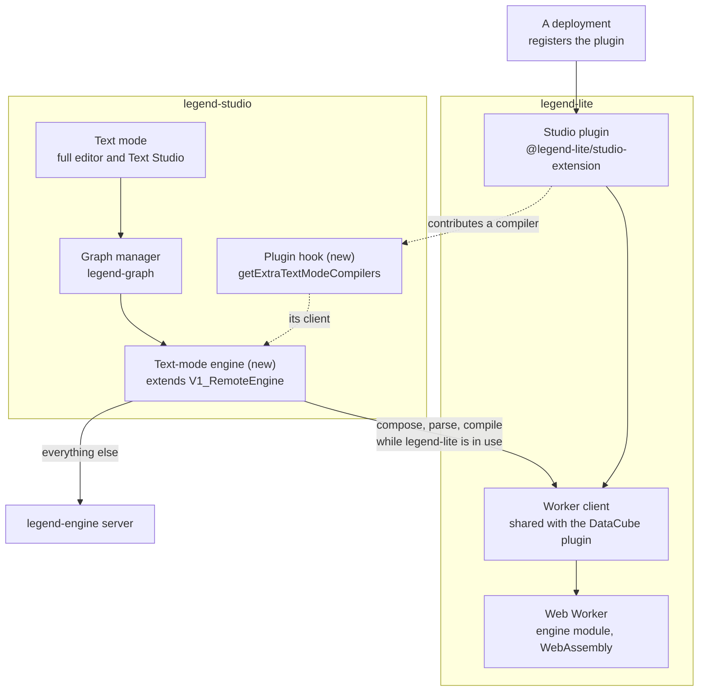
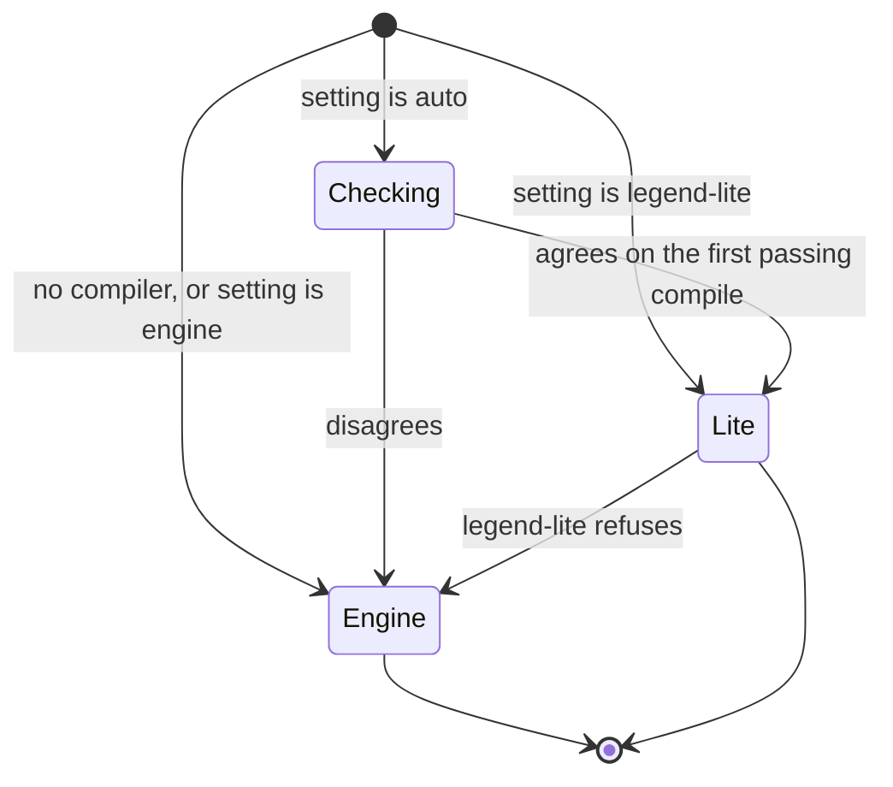
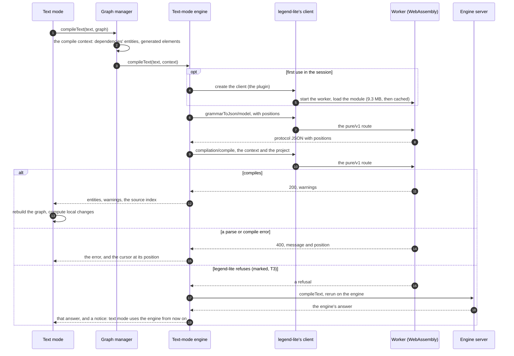
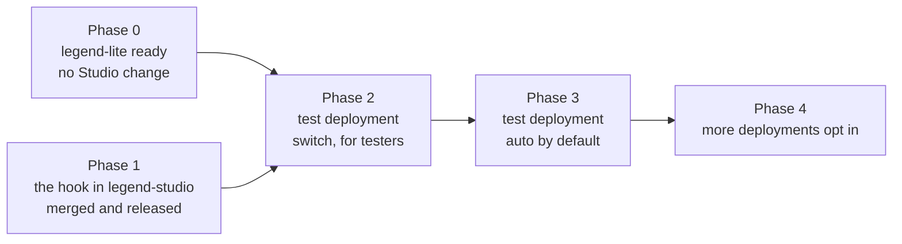

# Legend Studio's text mode on legend-lite's WebAssembly compiler: a plan (2026-11-23)

**Status:** proposed. Nothing in it is built yet. The probes in section 4 were run on 2026-11-23, and their scripts and
outputs are in [`legend-studio-text-mode-homework/`](legend-studio-text-mode-homework/README.md).

**What changed (the user, 2026-11-23):** Legend Studio, not DataCube, is the first product to use legend-lite.
The DataCube proposal ([`LEGEND_STUDIO_INTEGRATION_PROPOSAL_2026_11_18.md`](LEGEND_STUDIO_INTEGRATION_PROPOSAL_2026_11_18.md))
and its pull requests are parked: the hook,
[finos/legend-studio#5951](https://github.com/finos/legend-studio/pull/5951) (a draft), and the plugin,
[neema2/legend-lite#120](https://github.com/neema2/legend-lite/pull/120). This plan reuses two parts of #120: the engine module as a package, and the client that
answers `pure/v1` routes from a Web Worker.

**What it builds on:**
- [neema2/legend-lite#113](https://github.com/neema2/legend-lite/pull/113) (open): legend-studio's own grammar round-trip suite passes 133 of 133 on its branch, and
  compile errors carry `sourceInformation` for Studio's text mode.
- [neema2/legend-lite#100](https://github.com/neema2/legend-lite/pull/100) (a draft): the two protocol routes Studio calls when it starts.

## Contents

- [1. The goal](#1-the-goal)
- [2. Decisions](#2-decisions)
- [3. How Studio's text mode works today](#3-how-studios-text-mode-works-today)
- [4. What legend-lite answers today](#4-what-legend-lite-answers-today)
- [5. The gaps](#5-the-gaps)
- [6. The design](#6-the-design)
- [7. The phases](#7-the-phases)
- [8. Risks](#8-risks)
- [9. Questions for legend-studio's maintainers](#9-questions-for-legend-studios-maintainers)
- [10. What was not verified](#10-what-was-not-verified)

## 1. The goal

In Studio's text mode, legend-lite's engine module does the three things the engine server does today. The module
is WebAssembly, run in a Web Worker in the browser tab.

1. **Compose:** turn the project's protocol JSON into the text the user edits.
2. **Parse:** turn the text back into protocol JSON, with each element's position.
3. **Compile:** compile that JSON together with the project's dependencies.

Both of Studio's text surfaces use it: the full editor's text mode and Text Studio (strict text mode). Everything else
Studio does stays on the engine server: form mode, tests, generation, execution, service registration and SDLC.

It rolls out in phases, starting with one test deployment.

## 2. Decisions

**Ruled by the user on 2026-11-23:**

| # | Question | Ruling |
|---|---|---|
| 1 | Which text surface | Both: the full editor's text mode and Text Studio. They share one code path |
| 2 | Which operations | All three: compose, parse and compile |
| 3 | How a session picks legend-lite | A switch first, for the test deployment. Later an "auto" mode, where legend-lite is used only after it agrees with the engine |
| 4 | When legend-lite fails during a session | Show legend-lite's parse and compile errors. When legend-lite refuses something it does not support, rerun on the engine and stay on the engine for the rest of the session. This departs from the DataCube step's rule that a failure is never retried on the engine |
| 5 | How it reaches a deployment | Through the published packages. A deployment that builds Studio from the published `@finos` packages can use only a hook that is merged and released. legend-lite's packages are not on a public registry, so the deployment publishes them itself and loads legend-lite through a plugin it registers |
| 6 | The DataCube work | Parked. The discussion is reworded around Studio |

**Proposed here and not yet ruled.** Section 6 explains each.

- **A. What gets routed.** The design routes at the engine. While legend-lite is in use, every compose, parse and
  text compile in the session goes to it. That includes the diff views, the model importer and conflict
  resolution, which an earlier assumption kept on the engine. The alternative routes text mode alone, at the cost of
  a larger change to `legend-graph`. Recommended: route at the engine (6.3).
- **B. When the auto check runs.** The design checks on the first text-mode compile the engine passes, not at project
  load. In Text Studio those are the same moment. In the full editor, the check happens when the user first compiles
  in text mode. Recommended: the first passing compile (6.4).
- **C. When ruling 4 can work.** Today legend-lite's refusals look like ordinary errors. Until legend-lite marks them,
  ruling 4 behaves like "show legend-lite's error". The marker must cover two cases: "not supported", and the
  ledgered cases where legend-lite rejects a model the engine accepts. Recommended: mark both in phase 0 (6.6).

## 3. How Studio's text mode works today

Line numbers are legend-studio at
[`d564dd86d`](https://github.com/finos/legend-studio/tree/d564dd86d3681ae075855b66ca94ecd1584e0368).

**Three engine routes, and no others:**

| Route | Used for | Where |
|---|---|---|
| `grammar/jsonToGrammar/model` (`renderStyle=PRETTY`) | Entering text mode: the graph, or the workspace's entities, composed to text | `GraphEditGrammarModeState.cleanupBeforeEntering` (line 739); Text Studio's load, `EditorStore` (line 1063) |
| `grammar/grammarToJson/model` (`returnSourceInformation=true`) | The element index (go to definition, the cursor on entry), local changes, and the first half of every compile | `GraphEditGrammarModeState.initialize` (line 176) and `goToElement`; `V1_RemoteEngine.compileText` (line 687) |
| `compilation/compile` | The second half of every compile: F9, leaving text mode, and Text Studio's load | `V1_RemoteEngine.compileText` (line 687) |

**What Studio does with the answers.** Studio rebuilds its own graph from the parse output with its TypeScript graph
builder (`updateGraphAndApplication`, line 415). It also computes the workspace's local changes from that output. So
the protocol JSON legend-lite returns must be the JSON the engine would return. A difference shows up in the workspace
as a change nobody made. Errors come back as `ParserError` or `CompilationError`, and Studio puts the cursor at the
error's `sourceInformation`.

**The compile payload.** `V1_PureGraphManager.compileText` (line 2172) takes the compile context from the graph:
- the dependencies' entities, as they came from Depot;
- the generated elements.

`V1_serializePureModelContext` appends the dependencies' entity JSON to `elements`. `mergeObjects` then concatenates
that list with the parsed project's own elements, which include its section index. So a compile request holds:
- every dependency element;
- every project element;
- a section index that lists only the project's elements.

**Two surfaces.**
- **The full editor** builds its graph in the browser at load and calls none of these routes. They run when the user
  enters text mode, compiles there or leaves it, or when the graph can't be built and the editor falls back to text
  mode.
- **Text Studio** ("Strict Text Mode (BETA)") composes, parses and compiles the whole project on load, and never
  leaves text mode.

**The seam.** `V1_PureGraphManager.initialize` (line 773) already accepts an engine, typed `V1_GraphManagerEngine`.
Studio doesn't pass one today, so it gets the default `V1_RemoteEngine`. The comment above `V1_RemoteEngine` (line 261)
anticipates this: "this might change in the future if we ever bring some engine functionalities to Studio".
The engine's client is reached through `getEngineServerClient()`, on the engine taken as a `V1_RemoteEngine`, in 25
places: 11 in `legend-graph` and 14 outside it, 8 of those in the DataQuality extension. So whatever engine Studio
passes must still be a `V1_RemoteEngine`.

## 4. What legend-lite answers today

**Setup, 2026-11-23:**
- **legend-lite:** `0be02799d`, which is neema2/legend-lite#113's branch merged with `main` at `2942e9838` (the
  fork's branch `claude/sync-neema-main-2026-11-23`).
- **Module:** `//wasm:engine_planner_dir`, a 9.3 MB `classes.wasm`, run in Node 25.
- **legend-engine:** a local build reporting version 4.152.1-SNAPSHOT.
- **Cases:** legend-studio's 135 grammar round-trip cases (`legend-manual-tests`).

### 4.1 Studio's own round-trip suite, against each server

The module answered behind a 70-line local HTTP shim (`shim.mjs`). Each case runs twice, with and without Studio's
extensions.

| Server | Passed | Failed |
|---|---|---|
| legend-engine (local) | 266 of 270 | 4: the two `###GraphQL` cases, which this engine build can't parse either |
| legend-lite (module) | 265 of 270 | 5: the same four, plus `DSL_DataQuality-relation-comparison-advanced` with extensions. The engine writes `additionalColumnsToPersist: []`, Studio's extension writes it too, and legend-lite leaves the field out |

**What this checks, and what it doesn't.** Each case has Studio read one server's JSON, build its graph, serialize it
again and compare. It also has the same server compose and compile. So it shows that Studio accepts legend-lite's
output and that legend-lite round-trips Studio's cases. It doesn't compare legend-lite with the engine; 4.2 does that.

The two protocol routes Studio's suite calls when it starts (`getClassifierPathMap`, `getSubtypeInfo`) were passed
through to the engine; #100 adds them to legend-lite. Text mode doesn't call them.

### 4.2 legend-lite against the engine, on the same text

This calls `grammarToJson/model?returnSourceInformation=true`, as Studio's text mode does, on the 133 cases both
servers parse.

| Result | Cases |
|---|---|
| Identical JSON, every `sourceInformation` included | 124 |
| Differ only in `sourceInformation` (the end positions of multi-line string literals) | 1 |
| Differ in content | 8 |

**Each element's own position, which Studio indexes:** 929 of 929 identical.

The eight content differences:

| Difference | Engine | legend-lite | Cases |
|---|---|---|---|
| A function test's test data | `_type` and `elementPointer` | `packageableElementPointer` | 2 |
| A negative literal in a function test | the integer `-3` | `minus(3)` | 1 |
| `DataQualityRelationComparison` | writes `additionalColumnsToPersist: []` | leaves it out | 1 |
| A relational connection's `timeZone` | keeps the quotes, `'America/New_York'` | drops them | 4 |

**The cause is not established.** legend-lite's parity tests compare it with legend-engine 4.145.0, its pin. The
engine here reports a later version. Two things count against simply calling these newer-engine changes:
- #113 dates the DataQuality field to 4.148.0;
- this engine build can't parse `###GraphQL`, which Studio's own cases use.

**Unmeasured:** whether any of these differences changes the hashes Studio computes for local changes. That is the
first measurement of phase 0.

### 4.3 Errors

| Input | Engine | legend-lite |
|---|---|---|
| A parse error (missing `;`) | 400 `PARSER`, `sourceInformation` at the token | 400 `PARSER`, **no `sourceInformation`**. The position is only in the message, `[4:1] expected SEMI_COLON ...` |
| An unknown property type | 400 `COMPILATION`, `sourceInformation` at the type (line 3, columns 9 to 13) | 400 `COMPILATION`, `sourceInformation` covering the whole class (lines 1 to 4; register row S400) |
| An unknown property in a derived property | at the property access | the whole class |
| A function body of the wrong type | at the body | the whole function |
| A Pure class mapping with no `~src` | 200: compiles | 400 `COMPILATION`. legend-lite refuses it by ruling (register row S21), and nothing in the answer says it is a refusal |

The wording differs in every case. legend-lite's messages also start with `[line:col]`. Studio shows the message as it
is.

### 4.4 A compile with dependencies, as Studio sends it

A one-class "dependency", given as JSON, was appended to a project parsed by legend-lite with its section index, as
Studio's merge does it.

- **Engine:** 200.
- **legend-lite:** 400, `dep::Person: the model's section index lists no section for it`.

**This blocks text mode for any project with dependencies or generated elements** (gap T1).

### 4.5 Timings

Milliseconds, the mean of two runs (for the smallest model, the range):
- Both sides were already warm.
- legend-lite ran in Node 25, not a browser.
- The engine was local, reached over loopback, so there was no network and no upload.
- No dependencies were in the compile, because of 4.4.

| Model | Parse: lite / engine | Compose: lite / engine | Compile: lite / engine |
|---|---|---|---|
| Largest Studio case (10 elements) | 1 / 8 | 1 to 6 / 1 to 2 | 11 to 19 / 9 to 12 |
| Synthetic: 500 classes, 100 functions | 28 / 89 | 74 / 21 | 168 / 50 |
| Synthetic: 2,000 classes, 400 functions | 128 / 383 | 270 / 58 | 634 / 153 |

Against a warm local engine, legend-lite parses about 3 times faster. It composes about 4.5 times slower and compiles
about 4 times slower. A deployed engine adds the network, plus an upload of the whole project and its dependencies on
every compile; the module adds a one-time download of 9.3 MB.

## 5. The gaps

Each gap is in legend-lite unless the table says otherwise.

| # | Gap | Evidence | Needed before |
|---|---|---|---|
| T1 | Compile a request whose section index doesn't list every element (dependencies and generated elements) | 4.4 | Phase 2. **Blocker** |
| T2 | Parse errors carry `sourceInformation` in the engine's shape | 4.3 | Phase 2 |
| T3 | Mark refusals in the error answer: "not supported", and the ledgered cases where legend-lite rejects what the engine accepts (S21) | 4.3 | Phase 2 (ruling 4 relies on it) |
| T4 | Measure whether 4.2's differences change Studio's hashes; remove any that do | 4.2 | Phase 2 |
| T5 | Target the engine version the deployment runs. Rerun 4.1 and 4.2 against it, then align or ledger every difference | 4.2 | Phase 2 |
| T6 | The project's real dependency closures and sections, measured inside the deployment (a script; only counts leave) | none yet | Phase 2 |
| T7 | Compile errors placed on the expression, as the engine does, not on the whole element (S400) | 4.3 | Phase 3 (the cursor lands on the right element today) |
| T8 | Error wording: legend-engine's words, or a ledgered difference | 4.3 | Phase 3 |
| T9 | `###GraphQL`, and any other section the deployment's projects use | 4.1 | When a project needs it; T6 finds out |
| T10 | Speed: hold the dependencies in the worker across compiles, so each compile sends only the project | 4.5 | Phase 3, if T6's timings need it |
| T11 | Land #113 and #100 on legend-lite's `main` | | Phase 0 |

Every difference legend-lite keeps becomes a row of `docs/SEMANTICS_REGISTER.md`, posted to the user before it lands,
as for #113.

## 6. The design

Everything in this section is **proposed**. The hook, the routing engine and the setting are not built.

### 6.1 Where the code lives



legend-studio's packages are the published `@finos` ones. legend-lite's packages are published by the deployment
itself.

**In legend-studio**, one pull request against finos/legend-studio, released before any deployment can use it:
- `legend-graph`: `V1_RemoteEngine` can be built around a given `V1_EngineServerClient`. This is a few lines;
  today it always creates its own client.
- `legend-application-studio`:
  - the hook and its contract (6.2);
  - the text-mode engine (6.3);
  - the setting and a control for it in the Dev Tool panel, beside the engine client's switches;
  - a label in text mode's header that names who compiles;
  - the refusal handling (6.6) and telemetry (6.7);
  - a guide to writing such a plugin, as for DataCube;
  - tests.

**In legend-lite:**
- the engine module as an npm package (from #120's first commit);
- the worker client, taken out of #120's DataCube plugin so both plugins share it;
- a Studio plugin, `@legend-lite/studio-extension`, with a guide like the DataCube one: build, publish to a registry
  you choose, register, serve the module's files.

**In a deployment:**
- depend on the released `@finos` packages and on legend-lite's packages;
- add the plugin to `getPluginCollection()`;
- serve the module's two files.

### 6.2 The hook (proposed; the names are to be settled in review)

```ts
// @finos/legend-application-studio
interface LegendStudioTextModeCompiler {
  key: string; // names it in the setting
  label: string; // shown to the user: the setting, text mode's header, messages
  createEngineServerClient(): V1_EngineServerClient & { dispose?: () => void }; // called once, on first use
  isRefusal?(error: Error): boolean; // "this compiler does not support that": Studio asks the engine instead
  defaultMode?: 'off' | 'on' | 'auto'; // the setting's default, chosen by the deployment through the plugin
}

class LegendStudioApplicationPlugin {
  getExtraTextModeCompilers?(): LegendStudioTextModeCompiler[];
}
```

With no plugin contributing a compiler, there is no setting and nothing changes. This is the same shape as the
DataCube hook ([finos/legend-studio#5951](https://github.com/finos/legend-studio/pull/5951)): one client, created on first use, so the module is fetched only when text
mode first needs it.

### 6.3 How Studio routes: one engine subclass

Studio passes `V1_PureGraphManager.initialize` an engine of its own: a subclass of `V1_RemoteEngine`, built with the
same configuration as today. Being a subclass keeps working everything that reaches the engine as a `V1_RemoteEngine`:
- the tracer;
- `TEMPORARY__getEngineConfig`, which the Dev Tool panel uses;
- the 25 `getEngineServerClient()` calls in `legend-graph`, Studio and its extensions.

It overrides the engine methods below. While a compiler is in use, they go to a second `V1_RemoteEngine` built
around the compiler's client. Studio's request building and error mapping then stay as they are: parser and
compilation errors, the source index and warnings.

| Engine method | Called by | While legend-lite is in use |
|---|---|---|
| `transformPureModelContextDataToCode` | entering text mode; also the diff views, conflict resolution, the importer and a few editors | legend-lite |
| `transformCodeToPureModelContextData` | the element index, local changes in text mode; also the importer and conflict resolution | legend-lite |
| `compileText` | F9 and leaving text mode; Text Studio's load | legend-lite: parse, then compile |
| `transformProtocolGraphToCode`, `combineTextAndPMCD` | the data product editor; generation from text mode (the generation itself stays on the engine) | legend-lite |
| `compilePureModelContextData` | form mode's compile | the engine |
| lambda grammar, generation, tests, execution, service registration, the start-up routes | form editors and the rest of Studio | the engine |

**Open choice A: what gets routed.** Routing at the engine is the smallest change, and it keeps every text a session
shows composed by one implementation. But it also sends the diff views, the importer and conflict resolution to
legend-lite, and a refusal there moves the whole session to the engine. The alternative keeps those on the engine.
Text mode would then pass its own engine to four graph-manager methods, which means changing their abstract
signatures in `legend-graph`, or Studio would keep a second graph manager for text mode. **Recommended: route at the
engine**, and measure refusals outside text mode in phase 2.

### 6.4 The session's mode



- **engine:** today's behaviour.
- **legend-lite** (phase 2): legend-lite composes, parses and compiles from the first call.
- **auto** (phase 3): the session starts on the engine. The first time the engine compiles the project in text mode
  without error, Studio also asks legend-lite. If legend-lite compiles it too, with the same parse JSON, legend-lite
  serves the rest of the session. If not, the session stays on the engine, and the disagreement is reported in
  telemetry: counts only, never model content. This costs no extra engine call, and it compares the real request,
  dependencies included.
- **Leaving legend-lite is one way.** A refusal moves the session to the engine for good. A reload starts over.

**Open choice B: when the auto check runs.** "On loading of the project" is exactly this check in Text Studio, which
compiles on load. In the full editor, project load calls none of these routes. Checking there would cost an extra
compose, parse and compile on both sides for every session, including the many that never open text mode.
**Recommended: the first passing compile.**

### 6.5 A compile in text mode, in order



### 6.6 Failures (ruling 4)

- **A parse or compile error** from legend-lite is shown as Studio shows the engine's: a notification, the problems
  panel, and the cursor at the position.
- **A refusal** reruns the same call on the engine. The session switches to the engine, and the user sees a notice once.
- **The compiler decides what a refusal is** (`isRefusal`). legend-lite's plugin recognizes legend-lite's marker
  (T3).

**Open choice C: before T3, ruling 4 can't work.** Today legend-lite answers S21 and "not supported" as ordinary 400
errors (4.3), so Studio can't tell them from the user's mistakes. Until T3 lands, every legend-lite failure is shown
as it is, which is ruling 4's option "show legend-lite's error". The marker must also cover the ledgered cases where
legend-lite rejects what the engine accepts. Otherwise a model the engine compiles would be shown to the user as an
error. **Recommended: T3 in phase 0, before any tester uses the switch.**

### 6.7 Telemetry

Studio already logs text mode's launch, success and failure of compiles, with timings. Each event gains the compiler
that answered it. New events cover:
- a refusal, with its kind;
- an auto check's result, agreed or disagreed, with element counts.

None carries the text, the JSON or element paths.

## 7. The phases



Phases 0 and 1 run in parallel; phase 2 needs both. legend-studio's pull request carries everything Studio needs for
every phase: the switch, auto, the refusal handling and the telemetry. Each release is a wait for the deployment, so
phases 2 to 4 are a deployment's settings and legend-lite's releases, with no further change to legend-studio.

| Phase | Work | Exit |
|---|---|---|
| **0. legend-lite ready** | First T4: do 4.2's differences move Studio's hashes? Then T1 (blocker), T2, T3, T5 against the deployment's engine version, T11. Lanes in legend-lite for Studio's round trip through the module, the dependency request and the error shapes. The packages: module, shared worker client, Studio plugin and its guide. T6 inside the deployment | Studio's suite through the module matches the engine of the deployment's version. A project with dependencies compiles. Parse errors place the cursor. Refusals are marked. No difference that moves a hash is left |
| **1. The hook, upstream** | One pull request to finos/legend-studio (6.1 to 6.7), reviewed, merged and released | Released in `@finos/legend-application-studio` and `@finos/legend-graph`. legend-lite's plugin builds against the release |
| **2. Test deployment, by switch** | The deployment upgrades to the release, adds legend-lite's packages, registers the plugin and serves the module. Testers set the setting to legend-lite | Over an agreed period of real use, no phantom changes: entering and leaving text mode without edits leaves no local change. No verdict the pipeline contradicts. Refusals counted by kind. Compile times known on real projects |
| **3. Test deployment, auto** | The deployment's default becomes auto. T7 and T8, and T10 if the timings need it | The agreement rate on real projects is known and high, and no wrong verdict is reported |
| **4. More deployments** | Other deployments opt in. Once agreement is proven, auto may drop the engine comparison, which takes the engine out of text mode. Later candidates: form-mode compile, and the lambda grammar calls of the form editors (these need legend-lite's `valueSpecification` routes) | Each deployment's own phase 2 and 3 exits |

## 8. Risks

| Risk | Why it matters | Mitigation |
|---|---|---|
| **legend-lite accepts what the engine rejects** | The user commits it and the project's build, which compiles on the engine, fails. Telemetry can't see this | legend-lite's parser mutation tests and engine-dialect strictness; auto's agreement check; testers report pipeline failures in phase 2 |
| **Phantom changes** | A JSON difference becomes a local change in every workspace that opens text mode | T4 before phase 2. The no-edit check is an exit criterion |
| **Engine version drift** | legend-lite matches one engine version; deployments upgrade | T5: pin legend-lite's parity to the deployment's version, and rerun 4.1 and 4.2 on every upgrade |
| **Large projects** | Composing and compiling are about 4 times slower than a warm engine, and dependencies are recompiled on every compile | T6 measures real projects, T10 holds the dependencies, and auto keeps the engine where legend-lite disagrees |
| **The release wait** | Phase 2 can't start before the hook is released | One pull request with everything; phase 0 runs meanwhile |
| **A refusal outside text mode** | With routing at the engine, a refusal in the importer moves the session to the engine | Counted in phase 2; choice A can be revisited |
| **Download and memory** | 9.3 MB on first use, and a second copy of the model in the worker | Fetched only on first use, then cached by the browser; measured in phase 2 |

## 9. Questions for legend-studio's maintainers

1. Is a text-mode compiler hook in `legend-application-studio` acceptable? It is generic, and nothing changes without
   a plugin.
2. Route at the engine (every compose, parse and text compile while a compiler is in use), or text mode alone (choice
   A)?
3. May `V1_RemoteEngine` take an existing client?
4. One pull request with the switch, auto and refusal handling, or smaller steps, given each needs a release?
5. Are telemetry events that carry counts and timings, and never model content, acceptable?

## 10. What was not verified

- **A browser.** Every probe ran in Node 25 (V8, as in Chrome). No browser, worker or bundler was used. The DataCube
  step ran an earlier build of the module in a worker in Chrome on 2026-11-23.
- **Real projects.** Only Studio's 135 cases and two synthetic models were used. Real projects, their dependencies
  and their sections are T6.
- **The deployment's engine version.** The engine used reports 4.152.1-SNAPSHOT. Its differences from legend-lite
  (4.2) are not explained.
- **Studio's hashes** for 4.2's eight differing cases (T4).
- **Any Studio code.** The hook and the text-mode engine are designs, not code. That an engine subclass passed to
  `initialize` keeps every caller working is inferred from reading the code, not run.
- **Timings with dependencies** (4.4 stopped them), in a browser, or against a deployed engine.
